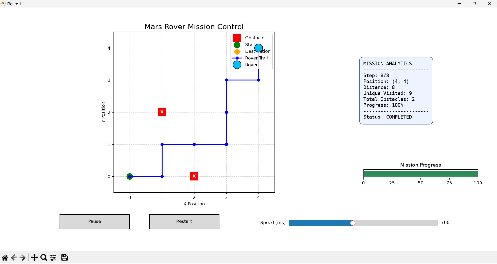

# 🚀 Mars Rover Simulation

A Python-based Mars Rover simulation project focused on rover movement, obstacle avoidance, boundary detection, path tracking, mission analytics, and interactive visualization.

This project is being developed as a learning- and research-oriented portfolio project in robotics, autonomous navigation, and space exploration.

## 🖥️ Simulation Preview



## ✨ Features

- 🧭 Grid-based rover movement
- 🪨 Obstacle detection and avoidance
- 🛑 Boundary detection
- 🗺️ Rover path tracking
- 📊 Mission statistics and distance calculation
- 🎯 Destination checking and mission status
- 🎮 Interactive rover animation with playback controls

## 🛠️ Technologies

- Python 3.12
- Matplotlib
- PyCharm

## 📁 Project Structure

```text
Mars_Rover_Simulation/
├── main.py
├── boundary.py
├── visualize.py
├── .gitignore
└── README.md
```

## ⚙️ Installation

1. Install Python 3.12 or a compatible Python version.
2. Clone this repository:

   ```bash
   git clone https://github.com/Rifatkobir/Mars_Rover_Simulation.git
   ```

3. Open the project directory:

   ```bash
   cd Mars_Rover_Simulation
   ```

4. Install the required visualization library:

   ```bash
   python -m pip install matplotlib
   ```

## ▶️ How to Run

Run the command-line simulation:

```bash
python main.py
```

Run the rover visualization:

```bash
python visualize.py
```

## 🔬 Research and Future Improvements

Planned improvements include:

- More realistic 2D and 3D rover visualization
- Improved autonomous path planning
- Integration of real Mars rover data where appropriate
- More realistic terrain and navigation models
- Performance evaluation of obstacle avoidance and path-planning algorithms

The long-term goal is to explore autonomous rover navigation through simulation and develop a foundation for future research.

## 👨‍💻 Author

**RIFAT MD SHABKAT KOBIR**

Computer Science and Technology  
University of Electronic Science and Technology of China (UESTC)

## 📄 License

This project is currently developed for educational, portfolio, and research purposes. A formal open-source license may be added later.
